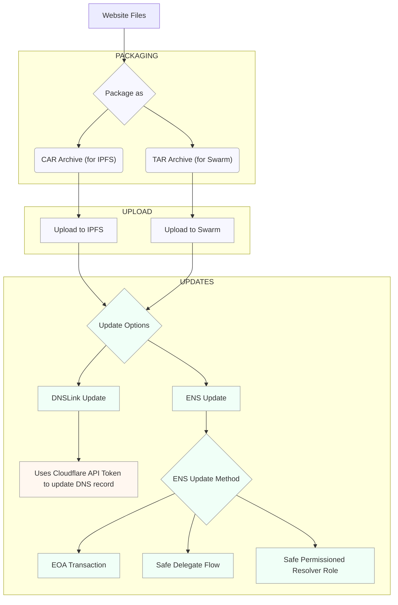

# How it works

Omnipin combines multiple technologies to provide the most secure, flexible and resilient website deployment tool. Omnipin's design is modular and allows plugging multiple protocols together, depending on specific needs.



## Re-pinning

The primary feature is uploading and re-pinning to multiple decentralized storage providers.

Since content on IPFS and Swarm has deterministic immutable hashes, it is possible to seamlessly replicate content (in a form of files or a DAG) into as many copies as possible. The reason why you would want to replicate content is to provide a fallback in case the first provider fails or does not have certain chunks of the new website version, while it is able to serve pre-existing chunks.

Omnipin scans the environment for provided API keys and tokens for storage providers, but is also possible to specify providers manually.

```sh
omnipin deploy --providers Pinata,Lighthouse
```

```jsonc
// Example provider list for an IPFS-hosted website
[
  {
    "ID": "QmUA9D3H7HeCYsirB3KmPSvZh3dNXMZas6Lwgr4fv1HTTp",
    "Addrs": [
      "/dns/dag.w3s.link/tcp/443/https"
    ],
    "Source": "IPNI"
  },
  {
    "ID": "12D3KooWNy17sJ97GTcTYRsbrp9qA19EDNGMaRFAFuJfa9NX9woq",
    "Addrs": [
      "/ip4/51.79.228.206/udp/25594/quic-v1",
      "/ip4/51.79.228.206/tcp/4000"
    ],
    "Source": "Amino DHT"
  }
]
```

## ENS Updates

In order to not have to type a full IPFS hash to open a website, as well as improve SEO, UX and have a transparent on-chain history of website updates, Omnipin integrates with ENS. It is an Ethereum-based alternative to DNS and it is possible to use ENS for serving websites. ENS has a special record type called [`contentHash`](https://docs.ens.domains/ensip/7). It contains an encoded hash which includes such information as the protocol version, codec data and the content hash itself, usually an IPFS CID.

Omnipin has multiple ways of updating ENS, varying in security and UX properties:

|  Type | Name theft protection  | Multi Factor Authorization | Restricted access | Complexity
|---|---|---|---|---|
| EOA | No 🚨 | No | No | Low
| Delegate | Yes | Yes | No | High
| Permissioned Resolver | Yes | No | Yes | Medium
| [Deploy Safe](#deploy-safe) (recommended) | Yes | Yes | Yes | High

### EOA

:::danger
In case of a key compromise, it is possible to steal all the assets held by the account, steal the ENS name in case it is wrapped, and alter any other records on the name in case it is unwrapped.
:::

A transaction is signed by a private key provided via `OMNIPIN_PK` and is immediately pushed onchain. There are no barriers or restrictions put on the account, so it is the least secure option. The only benefit of using an EOA is not requiring any custom setup.

In case EOA is still required and neither Delegate nor Permissioned Resolver options are available, it is recommended to take a list of security measures to minimize the potential risks of using an EOA for managing the ENS name:

* Don't use the account for storing any assets other than a tiny portion of ETH required to pay the transaction fees
* Save the private key in CI secrets to not be able to retrieve it from elsewhere
* If an ENS name is wrapped, unwrap it and set an owner to a different Ethereum account. In case the private key gets leaked, it is still possible to revoke access by changing the manager address.

### Delegate

An account derived from the private key provided via `OMNIPIN_PK` is not used to update ENS directly. It is only able to submit transaction proposals to a Safe wallet through Safe Transaction Service. It is a centralized API run by Safe which allows enqueuing transactions while not being one of the owners. Delegates have zero access to the ENS name and therefore are not able to perform ENS name theft or other malicious actions. Each transaction proposed by Safe requires manual review and approval from owners.

While the Delegate flow is the most secure option, it is also the most complex in management and requires manual approval every time a new transaction proposal is pushed.

#### Setup

1. Head over to the [Safe app](https://app.safe.global) and create a new wallet, if you don't have one yet.
2. Create a new Ethereum account that will be used for proposing transactions, save its private key to `OMNIPIN_PK`.
3. To add a delegate, go to the Safe app > Settings > Setup. Scroll down to "Delegates" and click "Add Delegate".


### Permissioned Resolver

A transaction is signed by a private key provided via `OMNIPIN_PK` and is immediately pushed onchain. Unlike pure EOA, the account is restricted to only be able to update an ENS name's `contentHash` record and does not manage the name. The name and its resolver are instead managed by a Safe wallet.

This uses the ENSv2 [`PermissionedResolver`](https://docs.ens.domains/). The Safe deploys the resolver and is its admin. On a new resolver the Safe receives all roles, including `ROLE_SET_CONTENTHASH`; on an existing resolver the role is granted to the Safe by default. A Safe proposer/delegate needs no role, because the Safe executes the call. Optionally, the role can be granted to a dedicated CI key, which can then call `setContenthash` directly without creating a Safe proposal for every deploy.

#### Setup

1. Head over to the [Safe app](https://app.safe.global) and create a new wallet, if you don't have one yet.

2. Set your ENS name manager address to the Safe.

3. Generate a Safe Transaction Builder batch with `omnipin resolver-setup`.
   By default the role is granted to the Safe. To allow unattended updates,
   pass a dedicated role key with `--role-address`:

```sh
# Safe executes updates (the proposer needs no role)
omnipin resolver-setup omnipin.eth --safe 0x0Fd2cA6b1a52a1153dA0B31D02fD53854627D262

# Grant the role to a dedicated CI key for unattended updates
omnipin resolver-setup omnipin.eth \
  --safe 0x0Fd2cA6b1a52a1153dA0B31D02fD53854627D262 \
  --role-address 0xYourCiKey

# omnipin resolver-setup omnipin.eth --safe 0x0Fd2cA6b1a52a1153dA0B31D02fD53854627D262 --verbose
# 🟢 Resolver will be deployed at 0x...
# ✔ Created resolver-setup.json in the current directory
# Open in a browser: https://app.safe.global/apps/open?safe=eth:0x0Fd2cA6b1a52a1153dA0B31D02fD53854627D262&appUrl=https%3A%2F%2Fapps-portal.safe.global%2Ftx-builder
# Upload resolver-setup.json in the UI
```

The batch deploys an ENSv2 `PermissionedResolver`, grants all roles to the Safe,
grants `ROLE_SET_CONTENTHASH` to `--role-address` when provided (otherwise to the
Safe), and points the name at the new resolver. If the name already uses a
permissioned resolver, only the role grant is generated.

4. Head over to the Safe [transaction builder](https://app.safe.global/apps/open?appUrl=https%3A%2F%2Fapps-portal.safe.global%2Ftx-builder) page.

5. Drag and drop `resolver-setup.json` and confirm transaction execution.

#### Usage

Updating ENS is now possible to do within a single command, while maintaining security properties of a Safe.

```sh
# Safe holds the role; the proposer needs no role
OMNIPIN_PK=<proposer key> omnipin deploy --ens omnipin.eth --safe 0x0Fd2cA6b1a52a1153dA0B31D02fD53854627D262

# Dedicated CI key granted with --role-address
OMNIPIN_PK=<role key> omnipin deploy --ens omnipin.eth
```

With a dedicated role key, omit `--safe`: the key sends `setContenthash`
directly to the resolver. The role is scoped to the resolver's root resource, so
use a dedicated resolver per project. The key cannot change other records or
transfer the name.

### Deploy Safe

Combines the Delegate flow and the Permissioned Resolver. The account that owns
the ENS name and the Safe that publishes deploys are kept separate:

- **Name owner** — an EOA or a Safe that owns the name and administers the
  resolver. It is used once during setup and can stay offline afterwards.
- **Deploy Safe** — holds only `ROLE_SET_CONTENTHASH` on the resolver. It does
  not own the name, so its owners can update the content hash but cannot
  transfer the name, change other records, or change the resolver.
- **Delegate** — `OMNIPIN_PK`. It can only propose transactions to the deploy
  Safe and has no access to the name or the resolver.

A leaked delegate key can only queue proposals that the deploy Safe owners have
to confirm. Even a compromised deploy Safe is limited to the content hash, and
the name owner can revoke its role or point the name at another resolver.

#### Setup

1. Create a deploy Safe in the [Safe app](https://app.safe.global), separate from
   the account that owns the name.
2. Add a delegate to the deploy Safe (Settings > Setup > Delegates) and save its
   private key to `OMNIPIN_PK`, as in the [Delegate](#delegate) setup.
3. As the name owner, deploy a permissioned resolver and grant the role to the
   deploy Safe:

```sh
# Name owned by an EOA: sends the transactions directly
OMNIPIN_PK=<owner key> omnipin resolver-setup omnipin.eth --role-address <deploy safe>

# Name owned by a Safe: writes resolver-setup.json for the owner Safe's Transaction Builder
omnipin resolver-setup omnipin.eth --safe <owner safe> --role-address <deploy safe>
```

Run this step locally. The owner key should never be stored in CI.

#### Usage

```sh
OMNIPIN_PK=<delegate key> omnipin deploy --ens omnipin.eth --safe <deploy safe>
```

The delegate proposes `setContenthash` to the deploy Safe, and the deploy Safe
owners confirm and execute it in the Safe UI.
