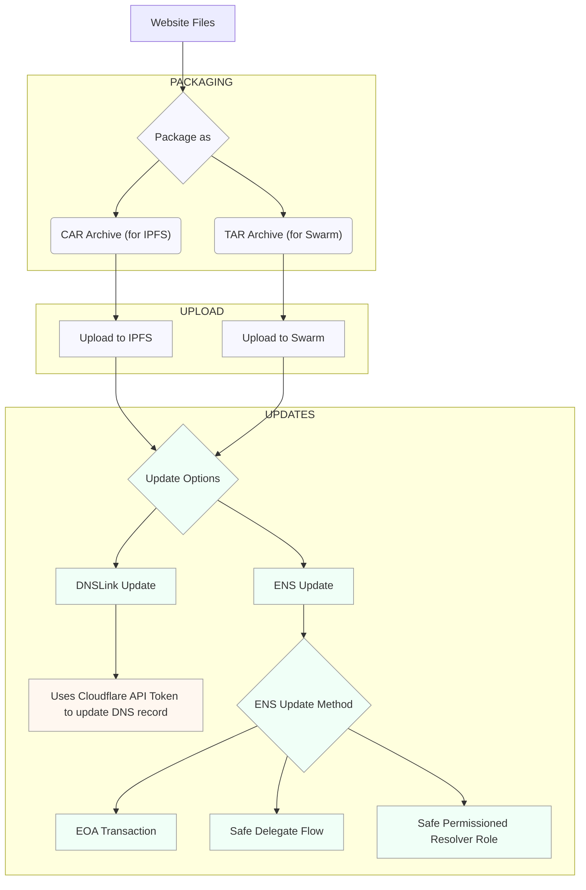

# How it works

Omnipin combines multiple technologies to provide the most secure, flexible and resilient website deployment tool. Omnipin's design is modular and allows plugging multiple protocols together, depending on specific needs.



## Re-pinning

The primary feature is uploading and re-pinning to multiple decentralized storage providers.

Since content on IPFS and Swarm has deterministic immutable hashes, it is possible to seamlessly replicate content (in a form of files or a DAG) into as many copies as possible. The reason why you would want to replicate content is to provide a fallback in case the first provider fails or does not have certain chunks of the new website version, while it is able to serve pre-existing chunks.

Omnipin scans the environment for provided API keys and tokens for storage providers, but is also possible to specify providers manually.

```sh
omnipin deploy --providers Pinata,Lighthouse
```

```jsonc
// Example provider list for an IPFS-hosted website
[
  {
    "ID": "QmUA9D3H7HeCYsirB3KmPSvZh3dNXMZas6Lwgr4fv1HTTp",
    "Addrs": [
      "/dns/dag.w3s.link/tcp/443/https"
    ],
    "Source": "IPNI"
  },
  {
    "ID": "12D3KooWNy17sJ97GTcTYRsbrp9qA19EDNGMaRFAFuJfa9NX9woq",
    "Addrs": [
      "/ip4/51.79.228.206/udp/25594/quic-v1",
      "/ip4/51.79.228.206/tcp/4000"
    ],
    "Source": "Amino DHT"
  }
]
```

## ENS Updates

In order to not have to type a full IPFS hash to open a website, as well as improve SEO, UX and have a transparent on-chain history of website updates, Omnipin integrates with ENS. It is an Ethereum-based alternative to DNS and it is possible to use ENS for serving websites. ENS has a special record type called [`contentHash`](https://docs.ens.domains/ensip/7). It contains an encoded hash which includes such information as the protocol version, codec data and the content hash itself, usually an IPFS CID.

Omnipin's ENS security is made of three independent layers. Each one removes a different risk, and they can be combined:

| Layer | Protects against | How |
|---|---|---|
| [Permissioned Resolver](#permissioned-resolver) | The publisher stealing the name or changing other records | The publisher only holds `ROLE_SET_CONTENTHASH` on the name's resolver |
| [Safe](#safe) | A single leaked key publishing a malicious version | Every update needs confirmations from the Safe owners |
| [Delegate](#delegate) | A leaked CI key compromising the Safe | The key in CI can only propose transactions; it is not a Safe owner |

Depending on which layers are used, `OMNIPIN_PK` holds a different key:

| Setup | `OMNIPIN_PK` | `--safe` | Permissioned Resolver | Safe | Delegate |
|---|---|---|---|---|---|
| [EOA](#eoa) | name manager key | — | ❌ | ❌ | ❌ |
| Role key | key holding the role | — | ✅ | ❌ | ❌ |
| Safe that owns the name | delegate key | owner Safe | ❌ | ✅ | ✅ |
| [Deploy Safe](#deploy-safe) (recommended) | delegate key | deploy Safe | ✅ | ✅ | ✅ |

### Permissioned Resolver

ENS records live in the name's resolver. Normally, whoever can update the content hash can also transfer the name, change its resolver, or change any other record. An ENSv2 [`PermissionedResolver`](https://docs.ens.domains/) splits these permissions into roles. The name owner administers the resolver and grants `ROLE_SET_CONTENTHASH` to the publisher, and the publisher can then set the content hash and nothing else.

The publisher can be any address: a plain key, a Safe that owns the name, or a separate [deploy Safe](#deploy-safe). The role key flow has no confirmations; the key sends `setContenthash` directly:

```sh
# Once, as the name owner (add --safe <owner safe> if a Safe owns the name)
OMNIPIN_PK=<name owner key> omnipin resolver-setup omnipin.eth --role-address <publisher>

# Every deploy, with a plain role key
OMNIPIN_PK=<role key> omnipin deploy --ens omnipin.eth
```

The role is granted on the resolver as a whole, so it covers every name that uses the resolver, including subnames without a resolver of their own. Use a dedicated resolver per project. The name owner can revoke the role or point the name at another resolver at any time.

The [Scoped Resolver guide](/docs/scoped-resolver) walks through the setup, including saving the existing records and rotating keys.

### Safe

A [Safe](https://safe.global) is a multi-signature wallet: a transaction executes only after enough of its owners confirm it. Using a Safe as the publisher means a single leaked key cannot publish a new version on its own.

Omnipin does not hold a Safe owner key. It proposes transactions with a [delegate](#delegate), and the owners confirm them in the Safe app.

### Delegate

The key provided via `OMNIPIN_PK` is not used to update ENS directly. It can only submit transaction proposals to a Safe through the Safe Transaction Service, a centralized API run by Safe which allows enqueuing transactions without being one of the owners. A delegate is not a Safe owner and has no access to the ENS name, so leaking it from CI cannot compromise the Safe or the name. Each proposed transaction requires review and approval from the owners.

#### Setup

1. Head over to the [Safe app](https://app.safe.global) and create a new wallet, if you don't have one yet.
2. Create a new Ethereum account that will be used for proposing transactions, save its private key to `OMNIPIN_PK`.
3. To add a delegate, go to the Safe app > Settings > Setup. Scroll down to "Delegates" and click "Add Delegate".


#### Usage

```sh
OMNIPIN_PK=<delegate key> omnipin deploy --ens omnipin.eth --safe <safe>
```

### Deploy Safe

The recommended setup uses all three layers. The name owner and the Safe that publishes deploys are separate accounts:

- **Name owner**: an EOA or a Safe that owns the name and administers the resolver. It is only used during setup.
- **Deploy Safe**: holds only `ROLE_SET_CONTENTHASH`. Its owners can update the content hash but cannot transfer the name, change other records, or change the resolver.
- **Delegate**: `OMNIPIN_PK`. It can only propose transactions to the deploy Safe and has no access to the name or the resolver.

A leaked delegate key can only queue proposals that the deploy Safe owners have to confirm. Even a compromised deploy Safe is limited to the content hash, and the name owner can revoke its role.

#### Setup

1. Create a deploy Safe in the [Safe app](https://app.safe.global), separate from the account that owns the name.
2. Add a [delegate](#delegate) to the deploy Safe and save its private key to `OMNIPIN_PK`.
3. As the name owner, grant the deploy Safe the role by following the [Scoped Resolver guide](/docs/scoped-resolver):

```sh
# Name owned by an EOA: sends the transactions directly
OMNIPIN_PK=<owner key> omnipin resolver-setup omnipin.eth --role-address <deploy safe>

# Name owned by a Safe: writes resolver-setup.json for the owner Safe's Transaction Builder
omnipin resolver-setup omnipin.eth --safe <owner safe> --role-address <deploy safe>
```

#### Usage

```sh
OMNIPIN_PK=<delegate key> omnipin deploy --ens omnipin.eth --safe <deploy safe>
```

The delegate proposes `setContenthash` to the deploy Safe, and the deploy Safe owners confirm and execute it in the Safe UI.

### EOA

:::danger
In case of a key compromise, it is possible to steal all the assets held by the account, steal the ENS name in case it is wrapped, and alter any other records on the name in case it is unwrapped.
:::

A transaction is signed by the name manager's private key provided via `OMNIPIN_PK` and is immediately pushed onchain. None of the layers above apply, so it is the least secure option. Its only benefit is not requiring any setup.

Even without a Safe, a [Permissioned Resolver](#permissioned-resolver) removes most of the risk: the key in CI can then only set the content hash. See the [Scoped Resolver guide](/docs/scoped-resolver). If the name manager key must still be used, minimize the risks:

* Don't use the account for storing any assets other than a tiny portion of ETH required to pay the transaction fees
* Save the private key in CI secrets to not be able to retrieve it from elsewhere
* If an ENS name is wrapped, unwrap it and set an owner to a different Ethereum account. In case the private key gets leaked, it is still possible to revoke access by changing the manager address.
