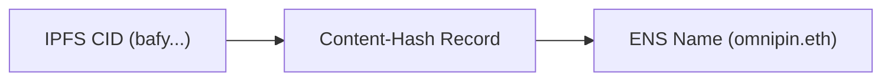

# Get Started

## Installation

Omnipin supports one of these JavaScript runtimes: [Node.js](https://nodejs.org) (22+), [Deno](https://deno.com) (2.2.11+) and [Bun](https://bun.sh).

:::code-group

```bash [npm]
npm i -g omnipin
```

```bash [pnpm]
pnpm i -g omnipin
```

```bash [bun]
bun i -g omnipin
```

```bash [deno]
deno install --global --allow-read --allow-env --allow-write --allow-net npm:omnipin
```

:::


## IPFS provider setup

### Initial deployment

The first step is setting up content storage providers to deploy the web application to. The full list is available with detailed instructions on the ["IPFS" page](/docs/ipfs). Filecoin will be used as an example because it allows permissionless uploads.

Storage on Filecoin requires FIL and USDfc for payment. In this tutorial, the Filecoin calibration testnet will be used.

Create a new Ethereum private key:

```bash [Terminal]
cast wallet new
```

Save the private key to the `OMNIPIN_FILECOIN_TOKEN` variable.

Request testnet FIL from [this faucet](https://forest-explorer.chainsafe.dev/faucet/calibnet) and USDfc from [another faucet](https://forest-explorer.chainsafe.dev/faucet/calibnet_usdfc) on a freshly created account.

Omnipin is now ready to deploy your app on IPFS.

Run `omnipin deploy` (will deploy `dist` directory by default) with the arguments below to make sure the testnet is used:

```bash [Terminal]
omnipin deploy --providers=Filecoin --filecoin-chain=calibration
```

```bash
🟢 Deploying with providers: Filecoin
📦 Packing dist (4.43MB)
🟢 Root CID: bafybeig2rerivrgw6y2bbh65hib2fxicmc7te4xygakkln4foocprcppeq
✓ [>>>>>>>>>>>>>>>>>>>>>>>>>>>>>>>>>>>>>>>>>>>>>>>>>>>>] Finished in 12s
✔ Deployed across all providers

# ...Filecoin logs

Open in a browser:
IPFS:      https://bafybeig2rerivrgw6y2bbh65hib2fxicmc7te4xygakkln4foocprcppeq.ipfs.dweb.link
Providers: https://delegated-ipfs.dev/routing/v1/providers/bafybeig2rerivrgw6y2bbh65hib2fxicmc7te4xygakkln4foocprcppeq
```

### Pin to other providers

Uploading a website to a single IPFS provider doesn't guarantee decentralization or censorship resistance. It is recommended to pin to at least 1-2 more IPFS providers.

Adding more IPFS providers is as easy as adding an API token, for example for [Pinata](https://pinata.cloud) it would be `OMNIPIN_PINATA_TOKEN`.

For a full list of supported IPFS providers, refer to the ["IPFS" page](/docs/ipfs).

## ENS Updates

Omnipin directly integrates with [ENS](https://ens.domains) (Ethereum Name Service).

Similarly to how DNS is used for websites to not expose raw IP addresses and be more human-friendly, ENS serves the same purpose for content hashes, for example IPFS CIDs.



Automatic ENS updates are as easy as supplying an extra CLI argument during deploy:

```bash
omnipin deploy --ens omnipin.eth
```

Omnipin needs a private key in `OMNIPIN_PK` to sign the update. Instead of the key of the wallet that owns your name, give it a throwaway account that is only allowed to update the website. If that key leaks, the attacker can change what the name points to, but cannot steal the name or change any of its other records.

### 1. Create a throwaway account

```sh
cast wallet new
```

This uses [Foundry](https://getfoundry.sh); any wallet works. Save the private key to `.env` and send the account a small amount of ETH to pay for transactions:

```sh [.env]
OMNIPIN_PK=<0xthrowawayprivatekey>
```

### 2. Allow it to update your name

From the wallet that owns the name, allow the throwaway account to update the website. Run this once, on your own machine, and pass the owner key inline instead of saving it anywhere:

```sh
# Preview first: simulates everything and sends nothing
OMNIPIN_PK=<name owner key> omnipin resolver-setup omnipin.eth --role-address <throwaway address> --dry-run

OMNIPIN_PK=<name owner key> omnipin resolver-setup omnipin.eth --role-address <throwaway address>
```

Under the hood, this gives the account the `ROLE_SET_CONTENTHASH` role on an [ENSv2 permissioned resolver](/docs/how-it-works#permissioned-resolver). If the name doesn't use one yet, the command deploys one and points the name at it.

:::warning
A new resolver starts empty, so the name's other records (ETH address, avatar, text records) stop resolving. Write them down before running the command and [re-create them](/cli/resolver-setup#re-creating-records) afterwards.
:::

If the name is owned by a Safe, add `--safe <owner safe>`: the command writes `resolver-setup.json` instead, which you upload in the Safe [Transaction Builder](https://app.safe.global/apps/open?appUrl=https%3A%2F%2Fapps-portal.safe.global%2Ftx-builder).

### 3. Deploy

```sh
omnipin deploy --ens omnipin.eth
```

Updating the ENS Content-Hash record requires paying a network fee. The fee varies depending on network load.

To replace or revoke the throwaway account later, see [Rotating or revoking access](/cli/resolver-setup#rotating-or-revoking-access).

:::tip Without the setup
Skipping step 2 and putting the name owner's key into `OMNIPIN_PK` also works, but a leaked key can then steal the name. Only do this for testing.
:::

### Adding a Safe

For more security, the role can be held by a [Safe](https://safe.global) instead of a throwaway account. Every update then needs confirmations from the Safe owners, so a leaked key cannot publish anything on its own. The key in `OMNIPIN_PK` belongs to a [proposer](/docs/how-it-works#delegate), which can only queue transactions for the owners to confirm. Proposers require a Safe Pro plan.

1. Create a Safe for deployments in the [Safe app](https://app.safe.global). It does not need to own the name.
2. Add the throwaway account as a proposer in the Safe settings.
3. In step 2 above, pass the Safe as `--role-address`.
4. Deploy with `--safe`:

```sh
omnipin deploy --ens omnipin.eth --safe eth:0xyourDeploySafe
```

The update is proposed to the Safe Transaction Service, and the Safe owners confirm and execute it in the Safe UI. See [Deploy Safe](/docs/how-it-works#deploy-safe) for the details.

## Automation with CI/CD

Omnipin seamlessly integrates with CI/CD pipelines.

All the previous steps can be automated in one GitHub Actions workflow. The workflow deploys a new version on IPFS every time a commit is pushed to the `main` branch and updates the ENS name with the throwaway account. Store its private key as the `OMNIPIN_PK` secret. With a [Safe](#adding-a-safe), add `--safe` with the Safe address to propose the update instead.

```yaml
name: Deploy with Omnipin
on:
  push:
    branches: main
jobs:
  deploy:
    runs-on: ubuntu-latest
    steps:
      - uses: actions/checkout@v4
      - uses: oven-sh/setup-bun@v2
      - name: Install Omnipin
        run: bun i -g omnipin
      - name: Build website
        run: bun i && bun run build
      - name: Deploy the site
        run: omnipin deploy .vitepress/dist --strict --ens ${{ vars.OMNIPIN_ENS }}
        env:
          OMNIPIN_PINATA_TOKEN: ${{ secrets.OMNIPIN_PINATA_TOKEN }}
          OMNIPIN_LIGHTHOUSE_TOKEN: ${{ secrets.OMNIPIN_LIGHTHOUSE_TOKEN }}
          OMNIPIN_4EVERLAND_TOKEN: ${{ secrets.OMNIPIN_4EVERLAND_TOKEN }}
          OMNIPIN_PK: ${{ secrets.OMNIPIN_PK }}
```

The "[CI/CD](/docs/ci-cd)" page describes integrations with other CI/CD providers, such as GitLab Actions.
